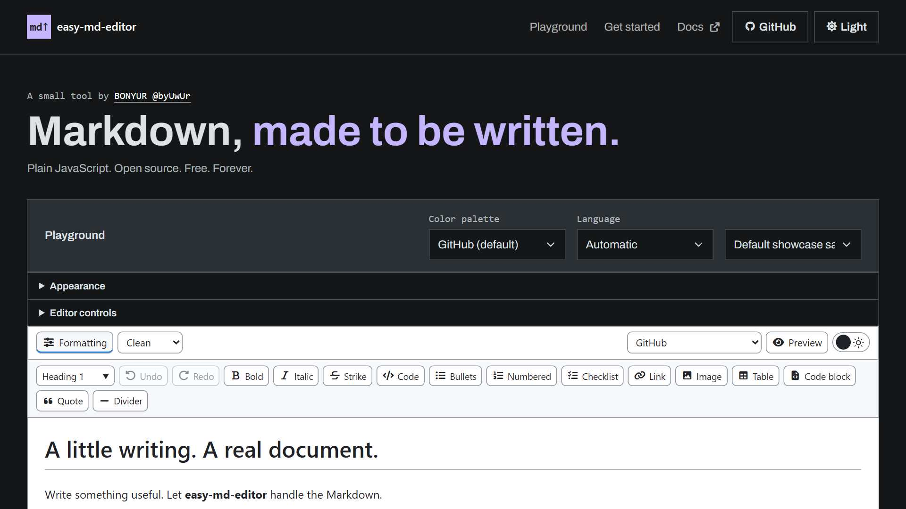

# MD.edit

Edit Markdown in place and read the original Markdown back when your application saves. MD.view supplies parsing and preview. CODE.view adds optional syntax highlighting.



## Index

1. [Quick start](#quick-start)
2. [Try it](#try-it)
3. [Downloads](#downloads)
4. [API and options](#api-and-options)
5. [Themes](#themes)
6. [Checks and releases](#checks-and-releases)
7. [Related projects](#related-projects)
8. [License](#license)

## Quick start

```html
<link href="https://cdn.jsdelivr.net/gh/byuwur/md.view@latest/md.min.css" rel="stylesheet" />
<link href="https://cdn.jsdelivr.net/gh/byuwur/code.view@latest/code.min.css" rel="stylesheet" />
<link href="https://cdn.jsdelivr.net/gh/byuwur/md.edit@latest/md.edit.min.css" rel="stylesheet" />
<script src="https://cdn.jsdelivr.net/gh/byuwur/code.view@latest/code.min.js" defer></script>
<script src="https://cdn.jsdelivr.net/gh/byuwur/md.view@latest/md.min.js" defer></script>
<script src="https://cdn.jsdelivr.net/gh/byuwur/md.edit@latest/md.edit.min.js" defer></script>

<div id="document" class="light" data-theme="github"></div>
<script>
  document.addEventListener("DOMContentLoaded", () => {
    const editor = byMDeditor(document.getElementById("document"), "# Hello\n\nStart writing.", {
      syntax: "clean",
      onChange(markdown) {
        // Your application handles saving.
      }
    });

    // Read this when your application saves or submits the document.
    const markdown = editor.getMarkdown();
  });
</script>
```

Pin a published tag in place of `@latest` for a fixed version. Visual modes require MD.view; source editing works on its own. Without CODE.view, fenced code stays editable as plain text. Your application owns saving.

### Offline use and Content Security Policy

For an offline host, serve `md.edit.js`, `md.edit.css`, `md.js`, and `md.css` locally, plus `code.js` and `code.css` when highlighting is wanted. MD is required for visual modes and Preview; CODE is optional. Extra palettes require local `md.themes.css`. Remove the Font Awesome `@import` from your local editor stylesheet to use text labels, or host that stylesheet and its referenced fonts locally. Keep `controlsCompact: false` when omitting icons. Content images also need local URLs for offline display.

Allow the script and style origins in your CSP. Authorize inline initialization and custom theme CSS separately, or move them into local files. The controls use static HTML templates and do not support enforced Trusted Types. Font Awesome needs `font-src`, and Markdown images need their origins in `img-src`.

## Try it

[Playground](https://mdedit.byuwur.co/)

The library contains no tracking. The [privacy policy](https://byuwur.co/privacy/dotview) and [cookie policy](https://byuwur.co/cookies/dotview) apply only to the hosted landing page and playground.

Run `node __tests__/serve.cjs` and open [the local playground](http://127.0.0.1:4173) to try editing, file import, starter export and Print / PDF.

## Downloads

[ZIP](https://github.com/byuwur/md.edit/releases/latest/download/md.edit.zip) · [Minified ZIP](https://github.com/byuwur/md.edit/releases/latest/download/md.edit.minified.zip)

## API and options

1. [API](#api)
2. [Options](#options)
3. [Languages](#languages)
4. [Supported Markdown and limits](#supported-markdown-and-limits)

The second argument accepts a string or an `HTMLElement` containing Markdown. Omit it to use the target's text. Each container owns its own state, history, and selection; initializing it again destroys its previous editor.

No database, network requests, autosave, or browser storage are built in.

### API

```javascript
editor.getMarkdown();
editor.setMarkdown("# Another document"); // Replaces the source and clears undo history.
editor.setSyntaxMode("assisted");
editor.setToolbar(false);
editor.setControls({ syntaxSelect: false, previewToggle: false, themeToggle: false });
editor.setAnimations(false);
editor.setAppearAnimation(true); // Requires animations to be enabled.
editor.setPreview(true);
editor.setTheme("dark");
editor.setPalette("github");
editor.getLanguage(); // Resolved language tag.
editor.setLanguage("es");
editor.focus();
editor.destroy();
```

`getMarkdown()` returns the last committed source. During IME composition, the browser owns the composing text until `compositionend`; reading the source does not interrupt it.

`onChange` is synchronous. Debounce expensive application work such as storage or remote requests outside the editor. Mode, theme, and selection changes do not call it.

`setControls(options)` also accepts `controlsCompact: true` for icon-only buttons; `false` restores their labels. It changes the visibility of `credits`, `toolbarToggle`, `syntaxSelect`, `previewToggle`, `themeToggle`, `paletteSelect`, and `statusBar` without rebuilding the document or resetting selection/history. Omitted keys retain their current values; `false` hides a control. Use `setToolbar()` for the formatting tools themselves. An empty control bar is hidden automatically.

`getSelection()` returns `{ anchor, focus }`. `setSelection(anchor, focus = anchor)` accepts UTF-16 source offsets, like JavaScript string indexes; reverse ranges preserve their direction. No-code projects positions inside hidden syntax onto visible text; read-only blocks expose their source boundaries. Select All still includes the complete Markdown.

`command(name, value?)` exposes the same formatting actions:

| Commands                                                                              | Value                                                                                                                                        |
| ------------------------------------------------------------------------------------- | -------------------------------------------------------------------------------------------------------------------------------------------- |
| `bold`, `italic`, `strikethrough`, `inlineCode`                                       | None                                                                                                                                         |
| `heading`                                                                             | Level 1-6; `0` means paragraph                                                                                                               |
| `paragraph`, `bulletList`, `orderedList`, `checklist`, `blockquote`, `horizontalRule` | None                                                                                                                                         |
| `link`, `image`                                                                       | `{ url, label }`; images also accept optional `size`; omit to open the insertion dialog                                                      |
| `imageSize`                                                                           | `"default"`, `"original"`, `"xs"`, `"small"`, `"regular"`, `"large"`, or `"xl"`; resize the selected image or the image containing the caret |
| `table`                                                                               | `{ rows, columns }`; omit for the size dialog; rows exclude the header                                                                       |
| `tableRowAbove`, `tableRowBelow`, `tableRowRemove`                                    | None; insert/remove a data row at the current cell in a visual editing mode                                                                  |
| `tableColumnLeft`, `tableColumnRight`, `tableColumnRemove`                            | None; insert/remove a column at the current cell in a visual editing mode                                                                    |
| `codeBlock`                                                                           | Language string, or `""` for plain code; omit for the language dialog                                                                        |
| `codeLanguage`                                                                        | Language string, or `"plain"` for plain code; change the hovered or current fenced block in a visual editing mode                            |
| `undo`, `redo`                                                                        | None                                                                                                                                         |

`destroy()` removes owned DOM and listeners and releases history. Keep the source before destroying if your application needs it. Read the library version with `byMDeditor.VERSION`.

Initialization and `setMarkdown()` throw `TypeError` for unsupported source types and `RangeError` above the document-size limit. `setSyntaxMode()`, `setTheme()`, and `setPalette()` throw `RangeError` for invalid names. `command()` returns `false` when an operation is unavailable, including in Preview; a command that opens a dialog may return before insertion. There is no asynchronous `ready` controller.

`language` and `setLanguage()` reject malformed language tags with `RangeError`. `translations` must be an object of string values; invalid overrides throw `TypeError` before replacing an existing editor.

Destroying an editor commits any active composition before cleanup, so `onChange` may run during teardown. Dispose the editor before removing its host, and keep application callbacks valid through that step. Duplicate script imports preserve the installed API.

### Options

| Option             | Default                                 | Meaning                                                                                                                     |
| ------------------ | --------------------------------------- | --------------------------------------------------------------------------------------------------------------------------- |
| `syntax`           | `"clean"`                               | `"no-code"`, `"clean"`, `"assisted"`, or `"source"`.                                                                        |
| `language`         | `"auto"`                                | Controls language; a language tag such as `"es"`, or automatic detection.                                                   |
| `translations`     | `{}`                                    | Per-instance text overrides, using the keys in `byMDeditor.locales.en`.                                                     |
| `animations`       | `true`                                  | Animate editor interactions and theme backgrounds. Overrides the system motion preference.                                  |
| `appearAnimation`  | `false`                                 | Fade the editor in on each mount when `animations` is enabled.                                                              |
| `toolbar`          | `true`                                  | Show formatting tools; users can collapse them.                                                                             |
| `toolbarToggle`    | `true`                                  | Show the Formatting button that opens or closes the toolbar.                                                                |
| `credits`          | `true`                                  | Show sticky attribution inside the document at the upper right.                                                             |
| `controlsCompact`  | `false`                                 | Hide button labels while retaining icons, tooltips, and accessible names.                                                   |
| `syntaxSelect`     | `true`                                  | Show the editing-mode selector.                                                                                             |
| `previewToggle`    | `true`                                  | Show the Preview button.                                                                                                    |
| `themeToggle`      | `true`                                  | Show the light/dark theme switch.                                                                                           |
| `statusBar`        | `false`                                 | Show editing status and guidance.                                                                                           |
| `shortcuts`        | `true`                                  | Enable Ctrl/Cmd+B, I, Z, Shift+Z, and Y.                                                                                    |
| `codeHighlighting` | `true`                                  | Use CODE.view for fenced-code colors while editing and in Preview.                                                          |
| `theme`            | Container theme, otherwise light        | `"light"` or `"dark"`; named palettes use container attributes below.                                                       |
| `palette`          | Container palette, otherwise `"github"` | `"monokai"`, `"github"`, `"solarized"`, `"high-contrast"`, or a custom CSS theme name.                                      |
| `fontSize`         | Container size                          | Number in rem or a CSS size such as `"1.25em"` or `"20px"`; bounded to `0.5rem`-`3rem`.                                     |
| `paletteSelect`    | `true`                                  | Show the palette selector; themes remain available through the API when hidden.                                             |
| `label`            | Localized "Document"                    | Accessible name for the editable document; an explicit value survives language changes.                                     |
| `placeholder`      | Localized "Start writing..."            | Hint for an empty editing surface; an explicit value survives language changes.                                             |
| `tools`            | All tools                               | Array of command names, plus `"heading"` for the paragraph-style selector.                                                  |
| `historyLimit`     | `200`                                   | Maximum undo entries, clamped to 0 to 1000. History also has a two-million-character budget; one large entry may exceed it. |
| `onChange`         | -                                       | Called with the complete Markdown after a committed edit or `setMarkdown()`.                                                |
| `onMeasure`        | -                                       | Optional development callback receiving `{ operation, duration, ... }` samples in milliseconds.                             |

For a smaller toolbar: `tools: ["heading", "bold", "italic", "link", "undo", "redo"]`. Set `controlsCompact: true` to hide button labels. Button titles include the supported Ctrl/Cmd shortcuts for Bold, Italic, Undo, and Redo when `shortcuts` is enabled. The paragraph-style menu previews the document's heading sizes in browsers supporting customizable selects; other browsers keep the standard text menu.

Use `editor.setAnimations(false)` to change motion without recreating the editor or resetting selection/history.

#### Syntax and Preview

**No-code** keeps Markdown delimiters hidden, including in the active line or code block. Format text with the toolbar. An inline formatting command at an empty caret inserts selected placeholder text for you to replace. **Clean** hides completed delimiters and reveals them in the active line. Code fences reveal together and resize their block with the syntax transition when animations are enabled and the browser supports intrinsic-size transitions. **Assisted** keeps them visible in a muted color, with stronger contrast on the active line. **Source** is a normal Markdown textarea. Clean remains the default.

Hover or edit a fenced code block to show its floating language selector. The selector is also reachable with Tab; Escape returns to editing. Changing the language preserves the code, fence markers, source line endings, and directed selection, and creates one undo step. Existing aliases and custom languages remain selectable. Plain Text disables code colors. Source and Preview do not show these controls.

For a fixed No-code interface, use `syntax: "no-code", syntaxSelect: false, previewToggle: false`. Visibility options hide controls; `setSyntaxMode()`, `setPreview()`, `setTheme()`, and `setPalette()` remain available to the host application.

Switching modes preserves the source exactly. Preview is read-only and uses the actual viewer, including its URL safety rules and optional code highlighting. Leaving Preview restores the editing selection. Preview renders on request, never during typing.

In Clean mode, placing the caret inside a code block reveals both fences, including the opening language such as `~~~javascript`. They hide again when you leave the block.

Code colors follow the fence language and selected palette. The editor reuses CODE's scanner for multiline strings and comments, debounces highlighting, and applies colors in short animation-frame slices. Typing and IME composition keep ownership of the caret; coloring never changes the Markdown or undo history. Source mode stays plain text.

#### Formatting

Use the toolbar for headings, paragraphs, bold, italic, strike, inline code, lists, checklists, links, images, tables, fences, quotes, and dividers. Commands act on the current selection. Inline formatting stays within one paragraph or table cell; paragraph styles apply outside tables.

In visual modes, typing text after a bare heading marker adds the required space (`###` then `Title` becomes `### Title`). Source mode keeps exactly what you type.

Enter inserts one line break, continues a list, or exits an empty list item. Press it twice to separate paragraphs. Shift+Enter inserts a Markdown hard break. In a table, Tab/Shift+Tab move between cells; Enter moves to the next row and adds a row at the end. Literal pipes are escaped for you. Shift+Enter and multiline paste leave a cell unchanged because Markdown tables use single-line cells. Tab leaves ordinary prose normally.

Backspace at a closing formatting boundary removes a delimiter before deleting the word. Undo/redo share one history across modes; consecutive text input is grouped. Pasting accepts plain text/Markdown rather than HTML. Copy and Cut return the selected Markdown, including delimiters.

#### Table rows and columns

Click or move the caret into a table cell in No-code, Clean, or Assisted mode to show its floating controls beside the caret. The left column contains Row above, Row below, and Remove Row; the right contains Column left, Column right, and Remove Column. Every action uses the caret's current cell, including empty cells. Header actions insert data rows below the header; the header and final column cannot be removed. Tables can have up to 100 data rows and 20 columns through these controls.

Press Alt+F10 inside a cell to focus the controls. Arrow keys move through the two-column grid; Home/End move to the first/last enabled action. Enter or Space applies one, and Escape returns to editing. The controls stay within the viewport and follow `controlsCompact`. Each action creates one undo step, preserves unaffected cell source and line endings, and moves the caret into a nearby or inserted cell. Source and Preview hide these controls.

#### Image sizes

Click an image in No-code, Clean, or Assisted mode to open its floating row of size buttons. The row scrolls horizontally when space is tight. Keyboard users can focus the image and press Enter or Space to focus the current size, use arrow keys or Home/End to move between choices, and press Enter or Space to apply one; Escape closes the toolbar. Clicking elsewhere dismisses it. The image insertion dialog offers the same choices:

- **Default:** unchanged image behavior; no size metadata.
- **Original:** natural image width.
- **XS:** 96px; **Small:** 160px; **Regular:** 320px; **Large:** 480px; **XL:** 720px.

Explicit sizes preserve proportions and shrink to fit the document. Resizing changes only an optional comment immediately after the image, preserving its alt text, URL, and title:

```markdown

```

Each resize is one undo step in the shared history. Source mode edits this same Markdown, and Preview uses the viewer's matching image sizes while remaining read-only. Default removes the size comment. Images without metadata keep the editor's existing display behavior, including its height limit.

Image sizing requires MD viewer 2.8 or newer in both JavaScript and CSS. The playground and CI pin that companion release. Other Markdown engines supporting HTML comments show the image normally and ignore the sizing; engines that escape raw HTML may expose the comment.

### Languages

All eight control languages and required messages are built into `md.edit.js`; no language pack is needed.

| Language  | Tag  |
| --------- | ---- |
| English   | `en` |
| Español   | `es` |
| Português | `pt` |
| Français  | `fr` |
| Deutsch   | `de` |
| Italiano  | `it` |
| 日本語    | `ja` |
| 简体中文  | `zh` |

`language: "auto"` uses the nearest ancestor's `lang` attribute, then the browser language. Regional tags fall back to their base language (`es-MX` → `es`, `pt-BR` → `pt`). Unavailable languages use English; explicitly requesting one also warns that its dictionary is missing. Nothing is downloaded automatically.

```javascript
const editor = byMDeditor(target, markdown, {
  language: "es",
  translations: { formatting: "Formato del texto", preview: "Vista final" }
});
editor.setLanguage("fr");
```

Language changes update buttons, tooltips, dialog labels, placeholders, and accessibility messages. Markdown, selection, undo history, open dialog values, and active IME composition stay intact; `onChange` is not called. Existing document text and code-language identifiers are never translated. Explicit `label`, `placeholder`, and `translations` values remain application-owned.

Register a custom dictionary on `byMDeditor.locales` before mounting an editor, or before calling `setLanguage()`. Keys match `byMDeditor.locales.en`; missing messages fall back to English. Templates use `{document}`, `{level}`, `{palette}`, `{task}`, and `{number}` where applicable. Messages are plain text, never HTML.

The translated sample documents and language names live only in `index.html`. The playground's **Language** setting switches controls and untouched examples; edited or imported documents stay intact. **Restore sample** loads the example in the selected language. The rest of the landing page stays in English.

### Supported Markdown and limits

Visual editing supports ATX headings, emphasis/strike, ordinary code spans, flat lists and checklists, single-level quotes, links, image descriptions, GFM tables, fences, and dividers. Tables can be inserted with 1-100 data rows and 1-20 columns. Source editing preserves other constructs.

The toolbar covers these formatting commands, rather than every viewer setting or Markdown structure. The default playground document demonstrates all six heading levels and each editable formatting feature, including mixed emphasis, autolinks, an image, both list types, tasks, tables, quotes, a hard break, a divider, and highlighted code.

Complex nesting, indented code, comments, document markers, escapes/entities, and code spans with normalized whitespace remain literal where visual editing would lose source mapping. Lines longer than 8,192 characters stay literal. Soft-wrapped source lines are separate editing lines; Preview applies the viewer's paragraph rules. Source remains the fallback for unsupported extensions.

In No-code mode, unsupported block structures render as read-only fragments through the actual Markdown viewer; edit those blocks in Source. Escape backslashes and hard-break backslashes stay hidden, while entity spellings retain their literal source representation. Code contents remain visible; only their Markdown fences are hidden.

Ordinary No-code edits preserve hidden table separators and code fences; table controls update separators with their columns, while Source can edit either structure directly. Empty fenced blocks accept typing and paste without changing their source until the first edit.

Unchanged source preserves delimiters, whitespace, BOM, and mixed line endings. The source limit is 2,000,000 UTF-16 characters. Formatting deliberately changes only the selected source region.

Keyboard access, labeled controls, native dialogs, focus indicators, reduced motion, and forced-color styling are included. Tab enters/leaves the formatting toolbar; Left/Right and Home/End move between its tools. Source mode is the reliable raw-text alternative for assistive technology. Synthetic IME checks are automated; real mobile keyboards and screen readers still need device testing. This is not a claim of a completed WCAG audit.

## Themes

The editor shares MD.view’s themes. Use `theme` for light or dark mode and `palette` for the color scheme. Monokai, GitHub, Solarized and High Contrast are built in. Load [md.themes.css](https://github.com/byuwur/md.view/blob/main/md.themes.css) after the base stylesheet for the other palettes.

Options override container settings. Omit an option or pass `null` to keep its current value. The `fontSize` option scales the editing surface, source, and preview. Numeric values use rem. CSS sizes such as `20px` also work within the `0.5rem` to `3rem` range. Invalid appearance values throw `RangeError` before replacing the document.

```html
<div id="viewer" class="dark" data-theme="github"></div>
```

Use **Copy CSS** in the playground to export appearance settings. Set `--by-view-document-bg` for the outer background and `--by-view-container-bg` for panels and controls. Define custom palette variables on the component’s mode class and `[data-theme]` selector. For example:

```css
.byMDeditor.dark[data-theme="my-ocean"] {
  --by-view-bg: #102a43;
  --by-view-text: #f0f6fc;
}
```

### Palette names

`monokai`, `github`, `solarized`, `high-contrast`, `dracula`, `darcula`, `nord`, `catppuccin`, `catppuccin-frappe`, `catppuccin-macchiato`, `rose-pine`, `rose-pine-moon`, `gruvbox`, `gruvbox-material`, `tokyo-night`, `tokyo-storm`, `tokyo-moon`, `one`, `material`, `material-ocean`, `night-owl`, `synthwave`, `ayu`, `everforest`, `kanagawa`, `selenized`, `vscode`, `monokai-dimmed`, `discord`, `slack`, `bonyur`, `sakura`, `bubblegum`, `candy`, `rose-gold`, `lavender`, `cyberpunk`, `sunset`, `volcano`, `amber`, `terminal`, `paper`, `ink`, `ocean`, `forest`, `mint`, `ice`, `sepia`.

## Checks and releases

Use Node.js 22+ and run these commands from the repository root. For playground checks, place sibling checkouts of `spa.js` at `v20.16`, `code.view` at `v2.2` and `md.view` at `v3.2` next to this repository.

```sh
npm --prefix .github ci --ignore-scripts --no-audit --no-fund
node .github/node_modules/playwright/cli.js install chromium
export NODE_PATH="$PWD/.github/node_modules"
node --test --test-concurrency=1 __tests__/rendering.cjs __tests__/playground.cjs
node .github/scripts/build.mjs --tag v0.0.0-local
npm --prefix .github run release:test
```

In PowerShell, replace the `export` line with `$env:NODE_PATH = "$PWD/.github/node_modules"`. [CI](.github/workflows/rendering.yml) runs Chromium, Firefox and WebKit by default. Manual runs can target one browser.

The [release workflow](.github/workflows/release.yml) tests the regular and minified ZIPs. Both contain the runtime files, README and license. The build manifest records the version and source commit. The local build writes `dist/assets/` and `dist/RELEASE_NOTES.md`. Use `--offline` for local minification. Publish by pushing a version tag matching the library’s `VERSION` (for example, `v2` for version 2).

## Related projects

[CODE.view](https://github.com/byuwur/code.view) · [CSV.view](https://github.com/byuwur/csv.view) · [DIFF.view](https://github.com/byuwur/diff.view) · [JSON.view](https://github.com/byuwur/json.view) · [LOG.view](https://github.com/byuwur/log.view) · [MD.view](https://github.com/byuwur/md.view) · [XML.view](https://github.com/byuwur/xml.view) · [YAML.view](https://github.com/byuwur/yaml.view)

## License

[MIT](LICENSE.md) (c) Andres Trujillo [Mateus] byUwUr
