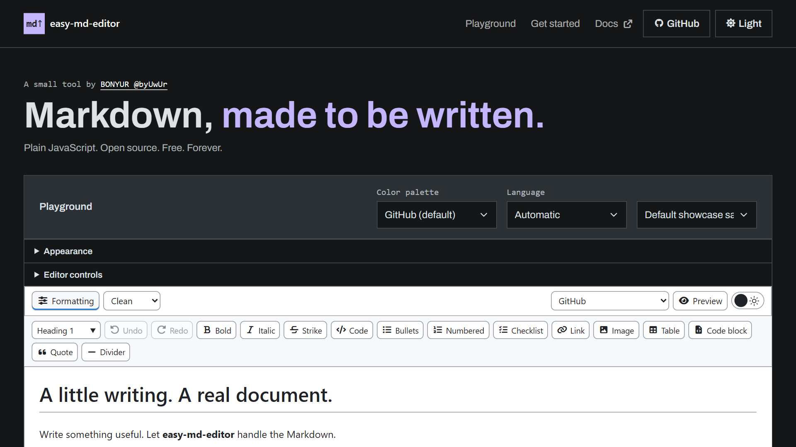

# byuwur/easy-md-editor



**Markdown, made to be written.**

Write a document, use familiar formatting tools, and get ordinary Markdown back. For notes, documentation, terms and conditions, and other text your application needs to store or move around.

The document is editable where it is rendered. No permanent split screen. No HTML-to-Markdown conversion. No storage decisions made for you.

Plain JavaScript. One editor script and one scoped stylesheet. No build step or editor engine. [easy-md-viewer](https://github.com/byuwur/easy-md-viewer) supplies the Markdown rules and exact Preview; [easy-code-viewer](https://github.com/byuwur/easy-code-viewer) highlights fenced code while editing and in Preview.

## Installation

Save `md.edit.js` and `md.edit.css` beside your HTML. Use the CDN for the companions:

```html
<link href="https://cdn.jsdelivr.net/gh/byuwur/easy-md-viewer@latest/md.css" rel="stylesheet" />
<link href="https://cdn.jsdelivr.net/gh/byuwur/easy-code-viewer@latest/code.css" rel="stylesheet" />
<link href="md.edit.css" rel="stylesheet" />
<script src="https://cdn.jsdelivr.net/gh/byuwur/easy-code-viewer@latest/code.js" defer></script>
<script src="https://cdn.jsdelivr.net/gh/byuwur/easy-md-viewer@latest/md.js" defer></script>
<script src="md.edit.js" defer></script>
```

Visual editing requires the MD viewer's `parseInline()` and `scanLine()` APIs; live code colors use CODE's `tokenize()` API. The playground pins its companions to numbered releases; documentation and exported examples use `@latest`. Use explicit release tags in deployed pages. In your own page, load the companions before creating an editor. An older or missing MD viewer logs a console warning and leaves Source editing available until reinitialization; missing CODE leaves fenced code editable as plain text.

`md.edit.css` imports Font Awesome for the toolbar icons. Buttons keep readable labels when icons are unavailable; no extra HTML import is needed.

The editor script fetches no assets. For offline use, keep the companion files locally too. To keep the icons offline, download Font Awesome and its fonts and point the import in `md.edit.css` to your local stylesheet. `@latest` follows published releases; pin a tag or commit when you need a fixed version.

## Usage

```html
<div id="document" data-theme="light"></div>
<script>
  document.addEventListener("DOMContentLoaded", () => {
    const editor = byMDeditor(document.getElementById("document"), "# Hello\n\nStart writing.", {
      syntax: "clean",
      onChange(markdown) {
        // Your application handles saving.
      }
    });

    // Read this when your application saves or submits the document.
    const markdown = editor.getMarkdown();
  });
</script>
```

The second argument accepts a string or an `HTMLElement` containing Markdown. Omit it to use the target's text. Each container owns its own state, history, and selection; initializing it again destroys its previous editor.

No database, network requests, autosave, or browser storage are built in.

## Options

| Option             | Default                                  | Meaning                                                                                                                     |
| ------------------ | ---------------------------------------- | --------------------------------------------------------------------------------------------------------------------------- |
| `syntax`           | `"clean"`                                | `"no-code"`, `"clean"`, `"assisted"`, or `"source"`.                                                                        |
| `animations`       | `true`                                   | Brief control/disclosure motion. `true` enables it and `false` disables it, overriding the system motion preference.        |
| `toolbar`          | `true`                                   | Show formatting tools; users can collapse them.                                                                             |
| `toolbarToggle`    | `true`                                   | Show the Formatting button that opens or closes the toolbar.                                                                |
| `syntaxSelect`     | `true`                                   | Show the editing-mode selector.                                                                                             |
| `previewToggle`    | `true`                                   | Show the Preview button.                                                                                                    |
| `themeToggle`      | `true`                                   | Show the light/dark theme switch.                                                                                           |
| `statusBar`        | `true`                                   | Show editing status and guidance.                                                                                           |
| `shortcuts`        | `true`                                   | Enable Ctrl/Cmd+B, I, Z, Shift+Z, and Y.                                                                                    |
| `codeHighlighting` | `true`                                   | Use easy-code-viewer for fenced-code colors while editing and in Preview.                                                   |
| `theme`            | Container theme, otherwise light         | `"light"` or `"dark"`; named palettes use container attributes below.                                                       |
| `palette`          | Container palette, otherwise `"monokai"` | `"monokai"`, `"github"`, `"solarized"`, `"high-contrast"`, or a custom CSS theme name.                                      |
| `paletteSelect`    | `true`                                   | Show the palette selector; themes remain available through the API when hidden.                                             |
| `label`            | `"Document"`                             | Accessible name for the editable document.                                                                                  |
| `placeholder`      | `"Start writing…"`                       | Hint for an empty editing surface.                                                                                          |
| `tools`            | All tools                                | Array of command names, plus `"heading"` for the paragraph-style selector.                                                  |
| `historyLimit`     | `200`                                    | Maximum undo entries, clamped to 0 to 1000. History also has a two-million-character budget; one large entry may exceed it. |
| `onChange`         | —                                        | Called with the complete Markdown after a committed edit or `setMarkdown()`.                                                |
| `onMeasure`        | —                                        | Optional development callback receiving `{ operation, duration, ... }` samples in milliseconds.                             |

For a smaller toolbar: `tools: ["heading", "bold", "italic", "link", "undo", "redo"]`.

Use `editor.setAnimations(false)` to change motion without recreating the editor or resetting selection/history.

### Syntax and Preview

**No-code** keeps Markdown delimiters hidden, including in the active line or code block. Format text with the toolbar. An inline formatting command at an empty caret inserts selected placeholder text for you to replace. **Clean** hides completed delimiters and reveals them in the active line. **Assisted** keeps them visible in a muted color, with stronger contrast on the active line. **Source** is a normal Markdown textarea. Clean remains the default.

For a fixed No-code interface, use `syntax: "no-code", syntaxSelect: false, previewToggle: false`. Visibility options hide controls; `setSyntaxMode()`, `setPreview()`, `setTheme()`, and `setPalette()` remain available to the host application.

Switching modes preserves the source exactly. Preview is read-only and uses the actual viewer, including its URL safety rules and optional code highlighting. Leaving Preview restores the editing selection. Preview renders on request, never during typing.

In Clean mode, placing the caret inside a code block reveals both fences, including the opening language such as `~~~javascript`. They hide again when you leave the block.

Code colors follow the fence language and selected palette. The editor reuses CODE's scanner for multiline strings and comments, debounces highlighting, and applies colors in short animation-frame slices. Typing and IME composition keep ownership of the caret; coloring never changes the Markdown or undo history. Source mode stays plain text.

### Formatting

Use the toolbar for headings, paragraphs, bold, italic, strike, inline code, lists, checklists, links, images, tables, fences, quotes, and dividers. Commands act on the current selection. Inline formatting stays within one paragraph or table cell; paragraph styles apply outside tables.

Enter creates a paragraph, continues a list, or exits an empty list item. Shift+Enter inserts a Markdown hard break. In a table, Tab/Shift+Tab move between cells; Enter moves to the next row and adds a row at the end. Literal pipes are escaped for you. Shift+Enter and multiline paste leave a cell unchanged because Markdown tables use single-line cells. Tab leaves ordinary prose normally.

Backspace at a closing formatting boundary removes a delimiter before deleting the word. Undo/redo share one history across modes; consecutive text input is grouped. Pasting accepts plain text/Markdown rather than HTML. Copy and Cut return the selected Markdown, including delimiters.

## API

```javascript
editor.getMarkdown();
editor.setMarkdown("# Another document"); // Replaces the source and clears undo history.
editor.setSyntaxMode("assisted");
editor.setToolbar(false);
editor.setControls({ syntaxSelect: false, previewToggle: false, themeToggle: false });
editor.setAnimations(false);
editor.setPreview(true);
editor.setTheme("dark");
editor.setPalette("github");
editor.focus();
editor.destroy();
```

`getMarkdown()` returns the last committed source. During IME composition, the browser owns the composing text until `compositionend`; reading the source does not interrupt it.

`onChange` is synchronous. Debounce expensive application work such as storage or remote requests outside the editor. Mode, theme, and selection changes do not call it.

`setControls(options)` changes any of `toolbarToggle`, `syntaxSelect`, `previewToggle`, `themeToggle`, `paletteSelect`, and `statusBar` without rebuilding the document or resetting selection/history. Omitted keys retain their current values; `false` hides a control. Use `setToolbar()` for the formatting tools themselves. An empty control bar is hidden automatically.

`getSelection()` returns `{ anchor, focus }`. `setSelection(anchor, focus = anchor)` accepts UTF-16 source offsets, like JavaScript string indexes; reverse ranges preserve their direction. No-code projects positions inside hidden syntax onto visible text; read-only blocks expose their source boundaries. Select All still includes the complete Markdown.

`command(name, value?)` exposes the same formatting actions:

| Commands                                                                              | Value                                                                  |
| ------------------------------------------------------------------------------------- | ---------------------------------------------------------------------- |
| `bold`, `italic`, `strikethrough`, `inlineCode`                                       | None                                                                   |
| `heading`                                                                             | Level 1–6; `0` means paragraph                                         |
| `paragraph`, `bulletList`, `orderedList`, `checklist`, `blockquote`, `horizontalRule` | None                                                                   |
| `link`, `image`                                                                       | `{ url, label }`; omit to open the insertion dialog                    |
| `table`                                                                               | `{ rows, columns }`; omit for the size dialog; rows exclude the header |
| `codeBlock`                                                                           | Language string, or `""` for plain code; omit for the language dialog  |
| `undo`, `redo`                                                                        | None                                                                   |

`destroy()` removes owned DOM and listeners and releases history. Keep the source before destroying if your application needs it. Read the library version with `byMDeditor.VERSION`.

Initialization and `setMarkdown()` throw `TypeError` for unsupported source types and `RangeError` above the document-size limit. `setSyntaxMode()`, `setTheme()`, and `setPalette()` throw `RangeError` for invalid names. `command()` returns `false` when an operation is unavailable, including in Preview; a command that opens a dialog may return before insertion. There is no asynchronous `ready` controller.

Destroying an editor commits any active composition before cleanup, so `onChange` may run during teardown. Dispose the editor before removing its host, and keep application callbacks valid through that step. Duplicate script imports preserve the installed API.

## Themes

Initial content appears immediately. Animations affect controls and deliberate show/hide actions; rows, tokens, and typing are not animated. Disclosure size/exit transitions progressively enhance browsers that support them.

The outer document and inner surfaces have independent CSS backgrounds. Both follow the selected theme unless overridden. Set `--by-view-document-bg: #0000` to reveal the host page while keeping content panels and individual controls readable. `--by-view-container-bg` sets the shared background of those panels and controls; it also accepts alpha colors or `transparent`. The toolbar and credits have no background. These overrides survive theme changes.

```css
.byMDeditor {
  --by-view-document-bg: #0000;
}
```

The playground uses SPA.js's Pickr assets for color and opacity, with text inputs when Pickr is unavailable. **Copy CSS** exports the appearance overrides; clear a field to restore its theme default. The renderer needs no color-picker dependency.

The editor uses the viewer's scoped variables and palettes. No global theme rules or separate light/dark files.

```html
<div id="document" class="dark" data-theme="github"></div>
<div id="accessible-document" class="light" data-theme="high-contrast"></div>
```

Monokai, GitHub, Solarized, and High Contrast each include light and dark modes. Use `setTheme("light")` / `setTheme("dark")` to change mode while retaining the palette, or `setPalette("github")` to change palette while retaining the mode. These changes apply to No-code, Clean, Assisted, Source, and Preview without changing the Markdown or undo history.

Custom palettes use the viewer's `--by-md-*` variables on `.byMDdocument[data-theme="your-name"]`, with `.dark` for the dark variant. The same rules reach the editor and its Preview. Select a custom name with `palette: "your-name"` or `setPalette("your-name")`; it appears in that editor's selector. Editor-only colors can override `--by-ed-bg`, `--by-ed-text`, `--by-ed-muted`, `--by-ed-border`, `--by-ed-alt`, and `--by-ed-accent` on `.byMDeditor`.

## Supported Markdown and limits

Visual editing supports ATX headings, emphasis/strike, ordinary code spans, flat lists and checklists, single-level quotes, links, image descriptions, GFM tables, fences, and dividers. Tables can be inserted with 1–100 data rows and 1–20 columns. Source editing preserves other constructs.

The toolbar covers these formatting commands, rather than every viewer setting or Markdown structure. The default playground document demonstrates all six heading levels and each editable formatting feature, including mixed emphasis, autolinks, an image, both list types, tasks, tables, quotes, a hard break, a divider, and highlighted code.

Complex nesting, indented code, comments, document markers, escapes/entities, and code spans with normalized whitespace remain literal where visual editing would lose source mapping. Lines longer than 8,192 characters stay literal. Soft-wrapped source lines are separate editing lines; Preview applies the viewer's paragraph rules. Source remains the fallback for structural table surgery and unsupported extensions.

In No-code mode, unsupported block structures render as read-only fragments through the actual Markdown viewer; edit those blocks in Source. Escape backslashes and hard-break backslashes stay hidden, while entity spellings retain their literal source representation. Code contents remain visible; only their Markdown fences are hidden.

Ordinary No-code edits preserve hidden table separators and code fences; use Source to change those structures. Empty fenced blocks accept typing and paste without changing their source until the first edit.

Unchanged source preserves delimiters, whitespace, BOM, and mixed line endings. The source limit is 2,000,000 UTF-16 characters. Formatting deliberately changes only the selected source region.

Keyboard access, labeled controls, native dialogs, focus indicators, reduced motion, and forced-color styling are included. Tab enters/leaves the formatting toolbar; Left/Right and Home/End move between its tools. Source mode is the reliable raw-text alternative for assistive technology. Synthetic IME checks are automated; real mobile keyboards and screen readers still need device testing. This is not a claim of a completed WCAG audit.

## Playground and checks

To serve the playground locally:

```sh
node tests/serve.cjs
```

Open [the local playground](http://127.0.0.1:4173), or use WAMP at `http://localhost/easy-md-editor/`. The playground loads its pinned companions from jsDelivr and requires those releases to be published. Open/download Markdown and Print / PDF belong to the demo, not the editor API. Printing uses the read-only viewer preview and the browser's print dialog.

The Get started section exports a complete HTML starter with CDN selected by default, or local files for offline use. Copy and Download use the displayed starter and default editor settings, independently of playground edits. CDN starters need published editor and viewer releases; local starters need `md.edit.js`, `md.edit.css`, `md.js`, `md.css`, `code.js`, and `code.css` beside the HTML.

Install Playwright outside the source tree or make it available through `NODE_PATH`, then run:

```sh
node --test tests/rendering.cjs
node --test tests/editor-options.cjs
node --test tests/playground.cjs
node tests/performance.cjs
```

Tests default to installed Chrome; `BROWSER_CHANNEL` and `CHROMIUM_EXECUTABLE_PATH` override the browser. Tests exercise actual companion files, not parser mocks. Library and option checks run separately from playground checks, which fetch pinned SPA.js assets from the CDN; `BOOTSTRAP_CSS_PATH` can supply a cached Bootstrap stylesheet. No SPA.js checkout is needed. [GitHub Actions](.github/workflows/rendering.yml) reports Library and Playground independently. Benchmarks cover 1,000/5,000/10,000 lines, large tables, nested lists, and fences at normal and 6× CPU slowdown. They report parse, edit, DOM patch, selection, preview, long-task, and heap measurements. `BENCHMARK_OUTPUT` optionally writes JSON outside the repository. Targets are measured engineering goals, not timing guarantees.

Ordinary input patches the affected line or row. Native word input preserves text nodes; Markdown punctuation and structure go through the shared parser. Offscreen groups use `content-visibility: auto` while retaining their DOM. Source mode builds no hidden visual document until needed. A full editor-line scan is reserved for initialization, source replacement, returning from changed Source mode, and changing the No-code representation. Full document rendering belongs to Preview. Code highlighting runs separately, caches unchanged fences, and cancels obsolete work on edits or teardown.

Measured in local Chrome with CODE loaded, a 1,500-row table, 5,000 code lines, and up to 10,000 prose lines: edit-handler p95 stayed below 1 ms normally, with no typing long tasks. At 6× CPU slowdown, most fixtures stayed below 2.5 ms; the 10,000-line document reached 8.3 ms. Selection p95 stayed below 0.5 ms. Browser layout still produced long tasks on large tables, nested lists, and code at that slowdown. Source mode remains the practical option for heavy documents on slower devices. These observations are machine-specific, not guarantees.

## The easy viewers

Need another format, or a Markdown editor? Explore the family:

[Markdown](https://github.com/byuwur/easy-md-viewer) · [JSON](https://github.com/byuwur/easy-json-viewer) · [CSV & TSV](https://github.com/byuwur/easy-csv-viewer) · [Logs](https://github.com/byuwur/easy-log-viewer) · [Diff](https://github.com/byuwur/easy-diff-viewer) · [XML](https://github.com/byuwur/easy-xml-viewer) · [YAML](https://github.com/byuwur/easy-yaml-viewer) · [Source code](https://github.com/byuwur/easy-code-viewer)

[Write Markdown with easy-md-editor](https://github.com/byuwur/easy-md-editor).

## License

MIT (c) Andres Trujillo [Mateus] byUwUr
